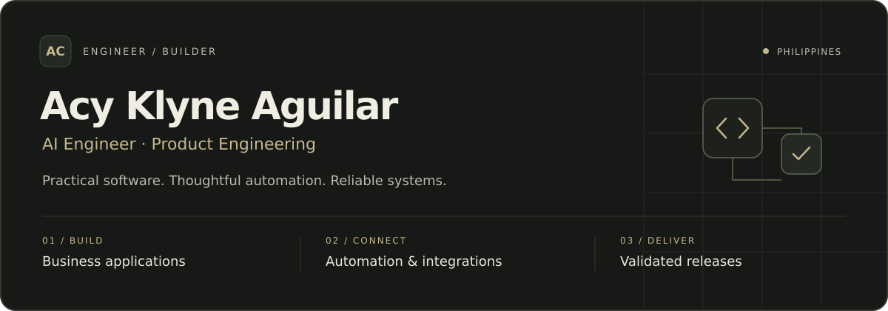

  

  <b>AI Engineer · Founder · Data Analyst · Developer</b>

  
  
  
  
  

  

---

## About me

I'm **AC — Acy Klyne Aguilar**, an **AI Engineer**, **Founder**, **Data Analyst**, and **Developer** with a Computer Science background from the **University of Cabuyao**.

Based in the Philippines, I currently work as an **AI Engineer at Gur Lavi Corp / Telavi**, contributing across software development, automation, systems integration, and reliable delivery.

I work with various programming languages and technologies, including **Python, JavaScript, Java, PHP, C++, SQL, and Bash**. My experience spans full-stack applications, data processing, machine learning, infrastructure, and hands-on technical support.

I enjoy understanding how the pieces fit together—from the interface people interact with to the services, data, and infrastructure behind it.

### Founder — The Techsmith

I lead **The Techsmith**, a tech solutions venture focused on web development, IT services, and small business empowerment.

This experience has strengthened my ability to understand client needs, manage project scope, communicate technical decisions, and deliver practical solutions from concept to deployment.

### Technician — Hands-on IT experience

My technical background includes **PC assembly, network setup, system diagnostics, troubleshooting, and hardware repair**.

Working directly with hardware and infrastructure gives me a practical perspective on software engineering: build systems that are reliable, maintainable, and suited to the environment where they operate.

### Data analytics — Lazada experience

At **Lazada**, I processed and validated **millions of logistics records** using **SQL and Python**, developed automation scripts for **finance-ready reporting**, and supported **billing accuracy** across third-party logistics partners such as **Ninja Van and Flash Express**.

That experience strengthened my attention to data quality, reconciliation, and the operational impact of accurate reporting.

---

## What I do

| Focus | How I contribute |
| :--- | :--- |
| **Full-stack software development** | Build and maintain web applications, backend services, and user interfaces. Work across **Python, JavaScript, PHP, Java, and C++**, with web frameworks and tools including **React, Next.js, Node.js, Laravel, Tailwind CSS, and Frappe**. Translate business requirements into practical, maintainable software. |
| **Data engineering & analytics** | Process and validate high-volume datasets using **SQL and Python**, build **ETL pipelines**, automate reporting, and investigate data discrepancies. Apply logistics analytics experience to support data quality, billing validation, and finance-ready reporting. |
| **AI & machine learning** | Develop predictive models using **TensorFlow** and machine learning techniques. Explore model deployment, real-time applications, and AI-assisted tools that support automation, debugging, and everyday problem-solving. |
| **Automation & systems integration** | Develop scripts and connect applications through **APIs, database operations, and workflow automation**. Troubleshoot integration issues, reduce repetitive manual work, and improve how information moves between systems. |
| **DevOps & software reliability** | Work with **Git, GitHub Actions, Docker, Linux, and Bash** to support version control, CI/CD, environment configuration, and deployment. Validate changes through testing, migration checks, and troubleshooting, with attention to recoverability and maintainability. |
| **IT infrastructure & hardware** | Assemble and troubleshoot PCs, configure networks, diagnose system issues, and perform hardware repairs. Investigate problems across applications, operating systems, connectivity, and physical devices. |
| **Product engineering & quality** | Break requirements into manageable work, investigate defects, and collaborate across technical and business teams. Check application behavior, permissions, integrations, and real user scenarios through regression testing and user acceptance testing. |
| **Entrepreneurship & technical delivery** | Lead **The Techsmith**, delivering web development and IT services for small businesses. Manage client communication, requirements, scope, and implementation—from understanding the problem to deployment and ongoing support. |

---

## Languages & tools

### Programming, scripting & query languages

  
  
  
  
  
  
  

### Frontend & web technologies

  
  
  
  
  
  

### Backend & application frameworks

  
  
  
  

### Data & machine learning

  
  
  
  

### Cloud, infrastructure & delivery

  
  
  
  
  

### Design & creative tools

  
  
  

---

## Currently exploring

- **Data engineering & analytics at scale**  
  Improving data pipelines, validation processes, and reporting workflows.

- **Cloud workflows & deployment**  
  Building on my AWS training and strengthening my understanding of cloud infrastructure and application delivery.

- **AI/ML deployment & real-time systems**  
  Exploring how predictive models and intelligent features can become useful, maintainable applications.

- **Full-stack development for business solutions**  
  Deepening my knowledge of application architecture, integrations, and user experience.

- **AI-assisted engineering**  
  Exploring developer tools that support debugging, automation, documentation, and technical problem-solving.

<b>Continuous learning — Frappe School</b>

 

I'm enrolled in the following courses to strengthen my application development and implementation skills:

1. **Full-stack App Development with Frappe Framework**
2. **ERPNext Essentials: A Complete Training Program**
3. **A Guide To Frappe Learning**
4. **ERPNext Implementation Guide**

---

## How I approach engineering

**Understand the problem. Build with care. Verify the result.**

- Start with the people, processes, and requirements behind the software.
- Break complex problems into focused, manageable changes.
- Write readable code and document decisions that matter.
- Test real user scenarios and investigate issues at their source.
- Consider reliability, maintainability, and support beyond the initial release.
- Collaborate openly and keep learning across software, data, and infrastructure.

I believe technology should be built with purpose—solving real problems, delivering value, and making systems work smarter.

Whether it's **code, circuits, or client conversations**, I bring the same mindset:

**Build it right. Make it work.**

> *“Innovation starts where curiosity meets execution.”*

---

## GitHub stats

  
  

  

Stats reflect the data available to these third-party services and may be temporarily unavailable. Repository language statistics do not represent my complete skill set or all professional work.

---

  <b>Build with purpose. Keep learning. Make it work.</b>

  <a href="https://github.com/acyklyne?tab=repositories">Explore my public repositories</a>
  &nbsp;·&nbsp;
  <a href="mailto:aguilaracyklyne64@gmail.com">Let's connect</a>

